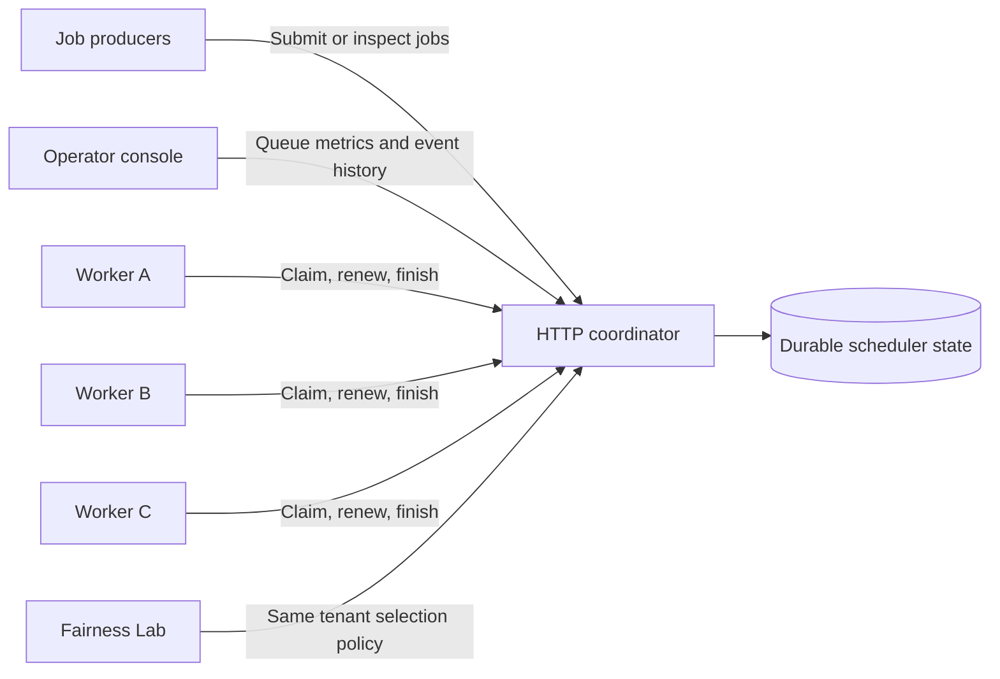

# FairSlot project plan

## Problem and product

FairSlot is a multi-tenant background job engine for teams that share a worker pool. A bulk export from one tenant can put order confirmations from another tenant behind thousands of jobs in a global FIFO queue. FairSlot gives runnable tenants a weighted share of dispatch capacity and records the reason for each claim.

The core demo is a reproducible noisy-neighbor incident. Start with 100,000 bulk jobs, then add 500, 300, and 200 jobs from three other tenants. Show the first dispatches, per-tenant p95 queue wait, and the outcome when a worker disappears. The operator can inspect a live job and see its attempts, scheduling reason, and lease recovery.

## Architecture

Workers run independently over HTTP and pull only when they have a free slot. SQLite uses the local coordinator clock. With PostgreSQL, coordinator replicas share the job ledger and use database time for lease decisions. A transaction locks the scheduler state row before changing jobs or leases, so concurrent replicas apply the same dispatch order and per-tenant caps. Workers can register capacity and use either replica to claim, renew, and finish leases.

## Dispatch policy

1. A tenant is eligible when it has a runnable job and an available concurrent lease slot. Delayed jobs stay outside the runnable set until their scheduled time.
2. For each eligible tenant, compute its effective virtual service as the greater of its stored service and the global virtual-service floor. Select the lowest value, breaking ties by least recent dispatch and then tenant ID.
3. Select a job within the tenant. Jobs past the aging threshold go first in order of eligibility. Otherwise select by priority, then eligibility time, then submission order.
4. Charge the selected tenant estimated job cost divided by tenant weight. Persist that charge, the selected effective service as the new global floor, the job lease, and the dispatch explanation in one transaction. The global floor limits credit accumulated while idle or quota-blocked.
5. Let eligible tenants borrow idle capacity. A weight is a relative service share among continuously eligible tenants with accurate cost estimates. Running jobs occupy slots until completion, retry, or lease expiry.

The release should report estimated service fairness and real execution time separately. Long jobs, skewed estimates, and caps affect observed share and tail latency.

## Delivery semantics

`queued → running → succeeded` is the normal path. A retryable failure or an expired lease returns a job to `queued` with a bounded exponential delay as long as it has attempts left. Exhausted and permanent failures become `dead_letter`. Workers renew active leases and include a unique lease token in all writes. Completion after expiry or reassignment is rejected. Submitters can provide a tenant-scoped idempotency key. Delivery is at least once, so handlers with external side effects need their own deduplication.

## Roadmap and acceptance criteria

| Milestone | Deliverables | Acceptance criteria |
| --- | --- | --- |
| 1. Runnable foundation | HTTP API, durable job ledger, weighted scheduler, priority aging, concurrent lease limits, worker executable, retry and dead-letter handling, operator console, deterministic FIFO comparison | Start with one command. Demonstrate independent workers, tenant isolation under load, persisted state across coordinator restarts, and stale lease rejection. |
| 2. Distributed control plane | PostgreSQL migrations, shared transactional scheduling, concurrent coordinator replicas, versioned worker protocol and worker registration | Show concurrent claims across two coordinators, fail one coordinator during a run, and prove job and event invariants after restart. |
| 3. Admission and operations | Separate operator, producer, and worker identities, per-tenant request and backlog limits, cancel and dead-letter replay, bounded retention, metrics and tracing, optional gRPC when justified by profiling | Exercise authorization boundaries, replay audits, dependency outage recovery, and dashboards for queue age and saturation. |
| 4. Feedback-based capacity | Estimate cost by job type from measured duration, expose queue age and utilization signals, add bounded worker concurrency tuning with cooldowns and manual limits | Compare fixed and adaptive policies against the same workload. Report throughput, queue wait, CPU and retry overhead with reproducible inputs. |
| 5. Release evidence | Load and fault suite, deployment example, runbooks, backup and restore, architecture decisions, recorded demo | Publish hardware, workload seed, sample size, throughput, p50/p95/p99 wait, fairness, recovery time, and known limits. Verify restore and replay on a clean environment. |

## Validation matrix

| Scenario | Evidence |
| --- | --- |
| One tenant floods the queue | Small tenants get early slots. Compare first dispatch and p95 wait under identical simulated pressure. |
| Sustained equal-cost demand | A 2:1 weight produces approximately 2:1 dispatch share without caps. |
| Mixed job costs | Estimated cost, rather than job count, follows configured weights over a sustained window. |
| Priority and aging | Newly queued high-priority jobs advance within a tenant. Aged eligible work takes precedence. |
| Worker process is lost | The lease expires, a fresh lease claims the retry, and the old worker cannot overwrite the outcome. |
| Coordinator restarts | Jobs, events, deduplication keys, and virtual service survive a clean restart. |
| Large queue and multiple hosts | Real load and fault tests capture service shares, wait tails, contention, and recovery. This is a release gate for milestones 2–5. |

## Build order and release gates

- **Storage and replicas.** SQLite and PostgreSQL share the ledger operations for submission, claim, renewal, completion, and sweeping. The PostgreSQL test starts two coordinators on the same ledger and stops one during active work. Measure contention under sustained load before considering partitioned scheduling.
- **Operator controls.** Add scoped credentials before enabling multi-host access. Define quotas for outstanding jobs, request rates, and active leases separately. Make cancellation and dead-letter replay audited state transitions. Keep the original failure and the new attempt linked for troubleshooting.
- **Capacity feedback.** Start with per-handler duration estimates and a fixed worker limit. Introduce feedback in an observation mode first. Compare its recommendations with the fixed baseline, then allow bounded changes with a cooldown and a manual override.
- **Release workload.** Run equal-cost, mixed-cost, bursty, and failure-heavy workloads on fixed hardware with recorded inputs. Run each case with one and two coordinators. Publish the benchmark commands and raw results along with scheduler and database utilization. Include recovery after losing a worker and while restarting a coordinator during sustained load.

Initial release targets are zero accepted stale completions, zero duplicate active leases in the ledger, and recovery of an abandoned attempt within one lease period plus backoff and polling time under healthy capacity. For weighted fairness, measure each continuously eligible tenant's estimated service over a dispatch window and compare it with its normalized weight. Establish numeric throughput and tail-latency targets after the first real load baseline.

## Risks and controls

| Risk | Design response |
| --- | --- |
| Duplicate external side effects after a crash | Pass a stable job ID to idempotent handlers and test a crash between side effect and acknowledgement. |
| Long jobs or inaccurate cost estimates skew runtime share | Show measured runtime alongside estimated cost and evaluate per-handler cost feedback. |
| A hot scheduler lock limits replica throughput | Measure lock wait, transaction duration, and throughput before changing transaction granularity. |
| Retries amplify a dependency outage | Keep maximum attempts and bounded delays. Add jitter, admission limits, and retry-rate metrics for multi-host operation. |
| Retained results and audit events grow indefinitely | Add configurable retention and payload limits before production rollout. |

## Milestone 1 scope

Node.js and SQLite provide a dependency-free local run. HTTP workers allow separate processes and can be placed on separate hosts through a properly secured coordinator. The initial lab models fixed-duration jobs and fixed capacity. Its queue times are virtual-clock results. The live dashboard displays actual queue state and outcomes from the coordinator.
